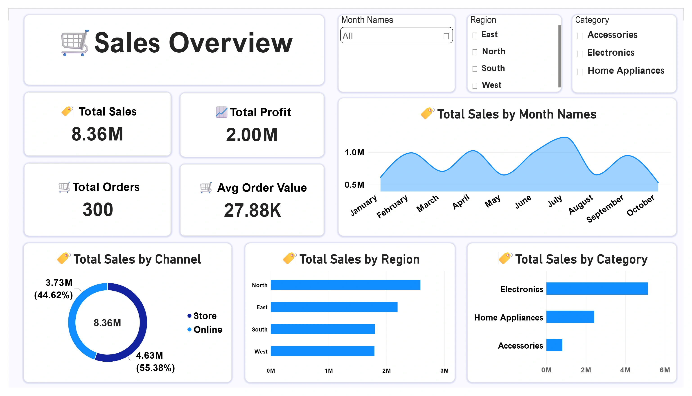
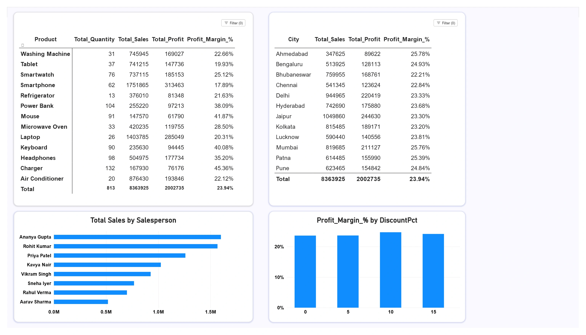

# TechZone India — Sales Performance Dashboard

A Power BI dashboard for a fictional Indian electronics retailer, built to answer one simple question for management:

> **We are selling a lot, but what is actually making profit, and where are we weak?**

Built with **Power BI Desktop only** — no Excel, Python, or SQL.

## Dashboard Preview




<h2 align="center">Sales Overview</h2>



<h2 align="center">Product and People</h2>

## Key Results

| KPI | Value |
|---|---|
| Total Sales | ₹8,363,925 |
| Total Profit | ₹2,002,735 |
| Profit Margin | 23.94% |
| Total Orders | 300 |
| Avg Order Value | ₹27,880 |
| Total Quantity Sold | 813 |

Period: **2 Jan 2025 – 31 Oct 2025**

## Key Insights

- **Electronics drives the business:** ₹5,138,955 in sales, followed by Home Appliances ₹2,418,620 and Accessories ₹806,350. Accessories has the highest profit margin at 40.9%.
- **North is the top region:** North ₹2,585,265, East ₹2,189,925, South ₹1,797,960, West ₹1,790,775.
- **Store beats Online:** Store ₹4,632,040 (55.38%) vs Online ₹3,731,885 (44.62%).
- **Top product:** Smartphone — ₹1,751,865 in sales.
- **Top salesperson:** Ananya Gupta — ₹1,600,035 in sales.
- **Top city:** Jaipur — ₹1,049,860 in sales.
- **Monthly trend:** Sales peak in July 2025 at ₹1,234,005 and are lowest in October 2025 at ₹530,975.
- **Discount trap:** Profit margin % is almost flat across discount levels (0%: 23.6%, 5%: 23.7%, 10%: 24.7%, 15%: 24.2%). Discounts reduce absolute profit, not margin %, because profit is discounted in the same proportion as sales.

## Dashboard Pages

### Page 1 — Sales Overview
- KPI cards: Total Sales, Total Profit, Total Orders, Avg Order Value
- Slicers: Month, Region, Category
- Total Sales by Month (Jan–Oct, in calendar order)
- Total Sales by Channel (Donut)
- Total Sales by Region (Bar)
- Total Sales by Category (Bar)

### Page 2 — Product & People
- Product table: Quantity, Total Sales, Total Profit, Profit Margin %
- City table: Total Sales, Total Profit, Profit Margin %
- Total Sales by Salesperson (Bar)
- Profit Margin % by Discount % (Column)

## Dataset

`TechZone_Sales_Data.csv` — 300 orders, 14 columns.

| Column | Description |
|---|---|
| OrderID | Unique order ID, e.g. ORD-1001 |
| OrderDate | Order date, 2025-01-02 to 2025-10-31 |
| Region | North / South / West / East |
| City | 12 cities, including Delhi, Mumbai, Bengaluru, Jaipur, Kolkata |
| CustomerSegment | Consumer / Corporate / Home Office |
| Category | Electronics / Home Appliances / Accessories |
| Product | 13 products, e.g. Laptop, Smartphone, Refrigerator |
| Quantity | Units sold per order |
| UnitPrice | Selling price per unit (₹) |
| UnitCost | Cost price per unit (₹) |
| DiscountPct | Discount applied, 0 / 5 / 10 / 15 |
| Channel | Online / Store |
| PaymentMethod | UPI / Card / Cash / Net Banking |
| Salesperson | 8 salespeople |

Sales and Profit are **not** in the raw file — they are calculated in Power Query. This is intentional, to practise data transformation.

## How It Was Built

### 1. Power Query — Clean & Calculate
- Imported the CSV with Get Data > Text/CSV
- Set correct data types: `OrderDate` as Date, Quantity / Price / Cost / Discount as Whole Number
- Added calculated columns:
  - `Total Sales = [Quantity] * [UnitPrice] * (1 - [DiscountPct]/100)`
  - `Total Profit = [Quantity] * ([UnitPrice] - [UnitCost]) * (1 - [DiscountPct]/100)`

### 2. Data Model — Calendar Table
Created a Calendar table in DAX and linked it to the sales table:

```dax
Calendar = CALENDAR(DATE(2025,1,1), DATE(2025,12,31))
```

Added columns with `YEAR()`, `MONTH()`, and `FORMAT()`:
- `Year = YEAR('Calendar'[Date])`
- `MonthNo = MONTH('Calendar'[Date])`
- `MonthName = FORMAT('Calendar'[Date], "mmmm")`
- `Quarter = "Q" & FORMAT('Calendar'[Date], "Q")`

`MonthName` is sorted by `MonthNo` (Sort by Column), so charts show Jan–Oct in calendar order, not alphabetical order. The month chart is also sorted by `MonthNames` on the visual itself, not by Total Sales.

Relationship: `Sales[OrderDate]` → `Calendar[Date]`

### 3. DAX Measures
```dax
Total Sales = SUM(Sales[Total Sales])
Total Profit = SUM(Sales[Total Profit])
Total Orders = DISTINCTCOUNT(Sales[OrderID])
Total Quantity = SUM(Sales[Quantity])
Avg Order Value = DIVIDE([Total Sales], [Total Orders])
Profit Margin % = DIVIDE([Total Profit], [Total Sales])
```

## How to Use

1. Download / clone this repository.
2. Open `TechZone_Sales_Dashboard.pbix` in Power BI Desktop.
3. Use the slicers on Page 1 to filter by Month, Region, and Category.
4. Click any bar, region, or category to cross-filter the whole page.
5. To refresh with new data, replace `TechZone_Sales_Data.csv` and click Refresh in Power BI Desktop.

No other tool is required to open or explore this dashboard.

## Project Structure

```
techzone-sales-dashboard/
├── README.md
├── TechZone_Sales_Dashboard.pbix
├── TechZone_Sales_Data.csv
└── screenshots/
    ├── sales-overview.png
    └── product-and-people.png
```

## Skills Demonstrated

- Power Query: data cleaning, data types, custom columns
- Data Modelling: Calendar table, relationships
- DAX: `CALENDAR`, `YEAR`, `MONTH`, `FORMAT`, `SUM`, `DISTINCTCOUNT`, `DIVIDE`
- Dashboard Design: KPI cards, slicers, cross-filtering, sorting months correctly
- Business Analysis: turning sales data into decisions on products, regions, channels, and discounts

## Note

TechZone is a fictional company and the dataset is synthetic, created for learning and portfolio purposes.

## Author

Akram Chaudhary
